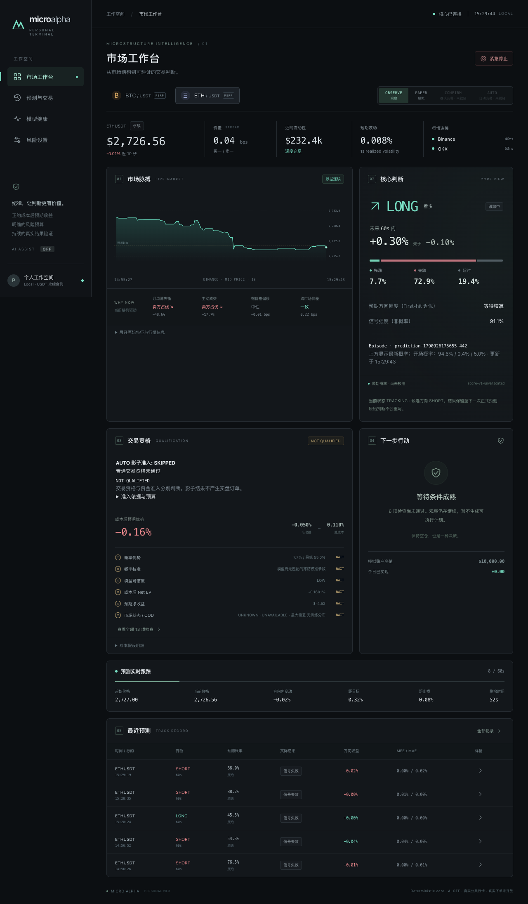

# Micro Alpha · 个人量化工作台

基于随附 `micro-alpha-trading-commercial-v1.0.3` 产品合同实现的本地个人版。面向 Binance / OKX 的 **BTC、ETH USDT 永续合约**，默认 **OBSERVE**。

当前交付为 **v0.3 个人版（对齐文档 v1.0.3）**：已接入 P0–P3 的观察、自动结果、资格、PAPER、独立信号加仓、Binance / OKX 私有 REST 执行、CONFIRM / AUTO、受控重训与影子晋升流程。默认 OBSERVE，未配置账户时不能启用交易所执行。完整阶段对应见 [P0–P3 验收](docs/ACCEPTANCE-P0-P3.md)。功能测试通过不等于已证明盈利或已完成交易所模拟账户 / 实盘验收。

v1.0.3 升级已加入：事件驱动特征与约 1 秒评估分离、连续机会 Episode 去重、开场 / 最新概率快照、信号 / 数据失效关闭、独立到期价格观察，以及 AUTO 专用准入、确定性候选排序、预算预留、重新入场冷却和次数上限。QUALIFIED 仍可被 AUTO 跳过，每次发送前重新检查并持久化准入依据。

升级原文保存在 [docs/spec-v1.0.3](docs/spec-v1.0.3/MASTER-CONTRACT.md)，逐项对应、默认参数和验收证据见 [当前验收记录](docs/ACCEPTANCE.md)。



## 运行配置与账户

| 项目 | 当前个人版要求 / 建议 |
|---|---|
| CPU / 内存 | 建议 4 核及以上、8GB 起步，16GB 更适合同时开发和研究 |
| 磁盘 | SSD，初始预留约 10GB 用于依赖、构建与缓存；持续行情录制另需空间 |
| 操作系统 | 当前已在 macOS 验证；其他系统尚未验收，启动脚本需要 Bash 环境 |
| 软件 | Node.js 22+、Rust stable；离线研究当前验证版本为 Python 3.13 |
| 网络 | 能访问 Binance / OKX 公共 HTTPS、WSS，系统时间应同步 |
| GPU / AI 服务 | 不需要独立显卡，不需要 OpenAI 或其他 AI API Key |

硬件数值是当前 BTC、ETH 两个标的工作负载的部署估算，并非长时间容量压测结论。持续运行需要保持主机唤醒、核心进程运行；仅关闭网页不会停止后台采集，电脑休眠或核心退出则会中断采集。

**当前读取的公开行情不需要交易所账号、登录密码或 API Key。** PAPER 由本机模拟账本执行，没有连接交易所的模拟账户或真实账户。

| 操作 | 凭证要求与当前支持情况 |
|---|---|
| 当前接入的盘口、公开成交、标记价格等行情 | 不需要账户鉴权，已接入 |
| OBSERVE 预测、PAPER 本地模拟 | 不需要交易所凭证，已实现 |
| 读取个人真实余额、持仓、订单 | 需要账户 API 凭证，已实现 REST 对账 |
| 真实下单、撤单 | 需要交易权限的 API 凭证，已实现并默认关闭 |

执行适配器的 HMAC 鉴权使用 Binance 的 API Key / Secret Key，或 OKX 的 API Key / Secret Key / API Passphrase；OKX 的 API Passphrase 是创建 API 时设置的口令，不是网页登录密码。凭证通过本机环境变量配置，详见 [执行账户配置](docs/EXECUTION.md)。无需网页登录密码。执行面板单独显示交易所账户与订单、持仓敞口与杠杆、保护动作及实盘成本 / EV 反馈，本地 PAPER 的记录仍独立保存。

接口鉴权依据：[Binance 安全类型](https://developers.binance.com/en/docs/products/derivatives-trading-usds-futures/general-info#endpoint-security-type)、[OKX 公开行情与 API 说明](https://www.okx.com/en-ae/help/okx-api-agreement)。

## 启动

需要 Node.js 22+ 和 Rust stable。此工作区已将 Rust 安装在 `.tools/`，启动脚本会自动使用；其他机器可安装 [Rust](https://rustup.rs)。

```bash
# 首次安装前端依赖
npm ci --prefix web

# 真实公共行情，不需要交易所 API key
./scripts/dev.sh

# 或使用完全独立的合成行情演示
./scripts/dev.sh --demo
```

打开 **http://127.0.0.1:3000**。核心监听 `127.0.0.1:8787`，前端通过同源 `/api` 代理访问。Ctrl+C 停止。两种行情源分别保存到 `data/live.sqlite` / `data/demo.sqlite`，不会混合模型统计。

更换独立数据目录：

```bash
MICRO_ALPHA_DATA=data/my-session ./scripts/dev.sh
```

需要直连交易所公共 HTTPS / WSS。WebSocket 不自动继承 HTTP 代理。连接或数据时间戳不符合门槛时，界面展示等待 / 过期，系统继续重连。只有演示启动参数会产生合成行情，断网不会自动降级成假行情。

## 如何使用

1. 在“市场工作台”选择 BTC / ETH，检查两家交易所的行情状态。延迟同时检查本机接收时间和交易所时间，不只检查 socket 是否连通。
2. OBSERVE 在方向离开中性区间并持续稳定后创建预测；弱信号显示 FLAT。预测结束后，原卡片展示自动结果、实际幅度和 MFE / MAE，至少保留 5 秒；原判断不会被重写。实时价格与门槛每秒刷新。
3. “预测与交易”提供自动结果、MFE / MAE、误差分类、独立人工注释、历史加载与 JSON 导出。注释不改变真实标签。
4. “模型健康”展示可比样本、概率分桶、ECE、Brier、近期 / 历史基线、当前市场状态内的样本与 ECE，以及相对训练分布的偏差。缺少分布或状态校准证据时，停止交易资格。
5. 设置个人风险预算与实际适用的成本假设。配置经过服务端验证，保存后生成版本与审计记录；已有持仓时禁止修改。
6. PAPER 仅在**新预测**通过全部资格门槛时模拟入场；不会因为切换模式追入已有信号。入场后持续重算资格与目标风险，可减仓、平仓；只有方向信号重新形成并确认，且增量 EV、间隔、次数与原止损预算均通过时才可 ADD。亏损不触发加仓。
7. 紧急停止立即阻止新模拟订单，默认保留持仓并继续 TP / SL / 超时保护。可在空仓时将行为改成 `flatten`。数据不可靠时，平仓保留为 `EXIT_PENDING`，不会使用旧价格假装成交。

初始真实市场模型是**未验证的确定性评分基线**，原始概率不冒充校准概率。其 Calibration 门槛不会通过，即使方向判断很强也不能模拟入场。演示模型有明确的 `synthetic-only` 标识，同样需要近期样本与可信度检查，不保证产生交易。

## 预测是否实时，以及如何理解概率

**实时描述行情和计算的更新方式；策略描述如何从行情形成判断。当前版本用实时行情执行文档第一阶段的确定性评分基线。**

| 环节 | 当前行为 |
|---|---|
| 行情接收 | WebSocket 事件到达后更新本地簿，并检查连续性和时间新鲜度 |
| 特征与交易资格 | 核心约每秒重算一次；网页在一次请求结束约 1 秒后再次读取状态 |
| 正式预测 | 每标的同时一条；默认方向确认 2 秒、创建间隔至少 5 秒、上条结果结束后冷却至少 5 秒；FLAT 不创建预测 |
| 预测卡片 | 保存建立时的方向、原始 / 校准概率、期限与屏障；跟踪期间不覆盖原判断；结束后原卡显示结果，直至下次正式预测 |
| 结果判定 | 每个有效 Binance 簿事件检查目标 / 反向屏障，时钟事件也检查超时；自动保存结果 |

行情延迟、请求耗时和主机负载都会影响刷新时间，不能把“每秒计算”理解为端到端延迟保证。默认数据过期阈值为 3 秒；Binance 主行情失效会使在途预测 `INVALIDATED`，OKX 跨市场数据缺失也会阻止完整交易资格。是否继续形成观察预测取决于 Binance 主行情是否可用。

当前默认预测窗口为 60 秒，方向内目标为 0.30%，反向屏障为 0.10%，可在风险设置中调整。这些是初始化参数，不是经过研究选出的最优参数，也不是文档要求固定使用的唯一组合。

压缩包定义了特征、First-hit 标签、校准、风险和验收规则，以及 `确定性评分 → 逻辑回归 → GBT` 的模型推进顺序；**没有提供经过训练的权重或已证明有效的策略**。当前基线权重由实现阶段设定，逻辑回归和温度校准工具已经实现，但不会自动替换运行中的模型。

新建真实行情数据空间、未加载研究模型时，模型状态为：

```text
model_version: score-v1-unvalidated
model_type: deterministic-score
validated: false
calibration_version: none
calibrated_probabilities: null
```

此时“先涨 80%”表示评分经归一化得到的**原始模型输出**，不代表已经验证的 80% 命中率。基线原始输出没有显式使用预测期限、目标和反向屏障，不能直接当作该组条件下的可靠 First-hit 概率。未经校准时，界面显示“原始概率 · 尚未校准”，Calibration 门槛阻止生成可执行计划。

“核心判断”展示建立预测时的数值，“交易资格”使用最新行情重新计算，所以两处概率或 EV 可能不同；保存的初始预测仍用于最终误差评估。即使显示已校准，仍需通过近期可比样本、Model Trust、成本后 Net EV 和所有其他门槛。**有预测、校准通过、具备交易资格是三个不同状态。**

评分公式、特征用途和验证门槛见 [架构说明中的模型细节](docs/ARCHITECTURE.md#标签与模型)。默认值与实时状态分别以风险设置和 `/api/state` 为准；已有数据空间重启时会恢复其配置及模型，不能根据上述初始化值推断当前运行状态。

## 离线研究与 Parquet

```bash
python3 -m venv .venv
.venv/bin/pip install -r research/requirements.txt

# 将一份完整行情日志导出为 Zstd Parquet 分块
.venv/bin/python research/parquet.py data/live-<session>.jsonl
# 追加 --watch 可在引擎运行时持续导出；磁盘写入不进入行情计算路径

# 基线先做温度校准，再比较逻辑回归；使用真实来源的自动 Outcome
.venv/bin/python research/train.py \
  --db data/live.sqlite --source live --model score --output data/research-score
.venv/bin/python research/train.py \
  --db data/live.sqlite --source live --model logistic --output data/research-logistic

# 或通过启动参数载入候选，只开始影子验证，不替换当前模型
./scripts/dev.sh --challenger data/research-score/challenger.json \
  --report data/research-score/report.json
```

研究采用三轮扩展训练窗口的 walk-forward：每轮重新拟合评分基线校准和逻辑回归，独立训练 / 校准 / 下一段验证，清除训练和校准跨边界的标签，三段验证不重叠。训练集按标的保存特征均值、标准差及市场状态边界；仅用校准集拟合各状态温度，少于 20 条的状态没有校准参数。报告检查整体、逐轮和状态内校准、校准覆盖率、成本后优势、回撤和尾部损失。导出工件是最后一轮模型，保留该轮独立验证结果，并记录分布、状态校准参数及 SHA-256。数据不足时拒绝研究或保持 `validated=false`。

此流程支持实时配对影子预测、证据比较、手动晋升到观察 / 模拟所用模型和单级回退。支持手动 / 定时生成研究候选，不在线修改生产权重，也不自动晋升。模型期限、屏障和成本必须与当前配置匹配；配置变化会暂停影子验证，需要用匹配的工件重新开始。

建议按下列顺序验证：

1. 使用真实行情 OBSERVE，保持研究窗口、屏障与成本配置一致，积累自动 Outcome；剔除数据失效，保留预测错误。
2. 用时间隔离的训练 / 校准 / 验证数据运行研究，检查 `report.json`，不能只看命中率或单一收益窗口。
3. 研究工具拒绝样本不足或门槛不通过的模型；通过时也只标记 `PAPER_RESEARCH_GATE_PASS`，不代表实盘许可。
4. 在“模型健康 → 影子模型与晋升”选择同一轮研究导出的 `challenger.json` 和 `report.json`，开始影子验证。界面展示样本、校准、收益、回撤、三个窗口、市场状态分组及未通过的门槛。
5. 证据充分后，在 OBSERVE、无持仓且行情 / 存储健康时点击“检查并晋升候选模型”。服务器重新检查，再切换冻结模型；保持 OBSERVE，重新积累当前模型的健康样本。
6. 满足全部交易门槛后使用 PAPER，比较实际模拟成本、收益和退出行为；执行适配器已接入；账户模拟环境和小额实盘仍需使用个人凭证验收。

默认运行时最低可比样本数是每标的及当前市场状态 30 条，这是可信度检查的起点，**不是训练完成或已经有效的证明**。当前离线工具另要求合并验证集至少 100 条、BTC / ETH 各至少 30 条、校准覆盖率至少 90%，并检查逐轮稳定性、状态内校准、成本后优势与尾部结果。具体规则见 [研究实现](research/train.py)。

如果启动时设置了 `MICRO_ALPHA_DATA`，研究命令的 `--db` 也应指向该目录。不能用演示数据库训练后，以真实来源模型名义加载。旧 checkpoint 可恢复；缺少训练分布和状态校准的旧真实模型不再输出校准概率，旧工件须重新研究生成后才能通过加载检查。重启同一数据空间会恢复已保存的模型和影子验证。直接用引擎 `--model` 绕过影子证据替换模型已停用（Python 研究命令中的 `--model score/logistic` 不受影响）。晋升后可在 OBSERVE、无持仓时点击“回退上一个模型”；仅保留最近一次晋升前的模型，账户损益不重置。

## 影子验证的证据与边界

候选模型使用当前模型新建预测的同一时点、特征、方向与屏障，只比较冻结概率和成本后优势；不会追补载入前的预测，也不会产生订单。结果由共同的后续价格路径自动判定，影子记录与正式 Outcome / 模拟账本分开。当前模型没有校准样本时，比较其预测误差，并要求候选独立通过收益与风险上限；不把“未交易”冒充一组可比的零回撤交易。

默认晋升要求至少 120 条有效配对结果、BTC / ETH 各 30 条、各出现的状态至少 20 条、总筛选样本至少 30 条，三个时间窗口各至少 5 条筛选样本。校准覆盖率至少 90%、ECE 不超过 12%、失效比例不超过 10%，两标的最近结果均不超过 5 分钟；整体、窗口和状态分组的成本后优势均须为正，并检查回撤、尾损及与当前模型的比较。阈值可在开始验证前编辑，随后随该次验证冻结；服务端拒绝超出研究边界的设置。

收益使用中间价路径减配置成本，回撤为单位名义价值统计，**不是影子模拟成交或实盘收益**。默认单位名义价值回撤上限为 5%、尾部 P05 损失上限为 0.5%、强反向结果比例上限为 20%。离线报告通过并不自动通过这些额外晋升门槛。报告与工件通过 SHA-256 配对，仍需信任本机研究数据与报告的来源；这不是第三方签名认证。

停止验证会记录尚未完成的配对编号；配置修改暂停验证。进程重启时，在途配对随原预测记为数据失效，已完成记录保留，运行中的验证继续等待新行情。可导出当前对比证据，历史影子事件和晋升证据保存在本地数据库及录制日志中。当前尚无真实候选模型通过完整晋升的有效性结论，自动测试使用合成数据验证流程。

## 验证

```bash
./scripts/check.sh           # Rust 测试 / Clippy、前端构建、Python 研究测试
./scripts/replay-check.sh    # 240 秒固定录制，核对完整状态 SHA-256

# 核心与前端运行后，执行浏览器测试；测试会切换模拟模式和修改测试账户配置
cd web
npm run test:e2e
```

浏览器测试默认使用 macOS 已安装的 Chrome。其他平台可设置 `CHROME_PATH`，或运行 `npx playwright install chromium`。

直接回放任何完整录制：

```bash
source scripts/env.sh
cargo run --locked -- --replay data/live-<session>.jsonl
```

记录包含启动状态、规范化行情事件、每秒时钟事件和用户控制操作，回放不访问网络、不使用当前时间。JSON 浮点启用精确 round-trip，订单簿价格使用 1e-6 整数刻度。生产与回放调用同一核心。

## 实现与边界

- **Rust + Tokio**：行情适配、本地簿、特征、预测、First-hit、资格、风险、模拟 / 私有 REST 执行、受控研究任务、HTTP API。Node 不进入行情计算路径。
- **Next.js + TypeScript**：中文工作台、行情图、历史、健康、配置和操作审计。
- **SQLite WAL**：个人本地记录与恢复；后台专用线程处理持久化。资金、日亏损、历史峰值和持仓恢复后，自动回到 OBSERVE，并使中断的预测失效。
- **JSONL + Python / Parquet**：规范化录制、精确回放与离线研究。无需 PostgreSQL、Redis、Docker 或云存储。

Ground Truth 使用 **Binance 本地订单簿中间价**和规范化接收时间，按接收到的完整簿事件确定屏障先后；OKX 用于跨市场特征与资格检查。它不声称重建网络延迟期间未观测到的真实交易所路径。发生可检测的数据完整性问题会产生 `INVALIDATED`，不纳入学习。

模拟成交按可见盘口逐档撮合，支持部分成交、显式费用与滑点，假设 IOC 且模拟确认延迟为零。资金费优先按公共公布的费率与结算时点模拟，缺失时使用保守预留；仍不是交易所真实扣款。清算缓冲是风险估计，并非交易所清算价。超时的基线预期收益假设为零。成本参数需通过持续录制、PAPER 与未来小额实盘逐步验证。

执行通过 REST 轮询对账，包含最小下单量、精度、账户模式、订单查询 / 撤销、部分成交、风险保护和重启恢复。当前没有私有 WS、交易所原生条件止损、可靠 OI / 清算流或影子成交模拟。前两项是部署能力边界，后两项在原合同中为可选 / 非必需；详见 [执行说明](docs/EXECUTION.md)。真实行情校准、长期稳定性与私有账户联调不能用合成测试替代。

完整阶段状态和验证记录见 [验收说明](docs/ACCEPTANCE.md)，原始文档保存在 [docs/spec](docs/spec/MASTER-CONTRACT.md)。


## 新增研究与运行工具

“模型健康 / 风险设置 → 执行与研究”可立即运行 score / logistic / GBT 候选训练，并设置每小时、每天或每周任务。也可用 CLI：

```bash
.venv/bin/python research/train.py --db data/live.sqlite --source live --model gbt --output data/research-gbt
.venv/bin/python research/quality.py data/live-SESSION.jsonl --db data/live.sqlite --output data/quality.json
source scripts/env.sh
cargo run --locked --example grid -- data/live-SESSION.jsonl > data/parameter-search.json
```

GBT 使用多分类梯度提升浅树，导出的固定树结构由 Rust 推理；每折先训练 score / logistic，GBT 必须与两者比较。参数搜索覆盖 5 / 15 / 30 / 60 / 120 秒、0.05–0.30% 的五档目标、三档止损；只在训练部分选组合，后段检查一次，末尾缺少未来路径的样本排除。它不会改配置，也不把旧定义的概率当成新屏障的校准概率。

点击“解释当前信号与模型状态”默认生成事实摘要。若配置 `MICRO_ALPHA_ASSIST_MODEL`，调用本机已安装的 Ollama 模型生成中文解释；失败自动回到事实摘要。没有下载模型或调用远程 AI；解释服务只读，不参与信号、资格、资金或订单计算。接口参考 [Ollama Chat](https://docs.ollama.com/api/chat)。

`/api/state` 的 `telemetry` 提供特征、资格检查与核心事件处理的 P50 / P95 / 最大耗时；特征中保留市场时间滞后，私有订单保留提交 / 确认 / 成交时间。运行时计时不参与确定性回放摘要。


P1 / P2 风险上下文已明确区分模拟与真实账户：两者使用同一资格 / 仓位公式，真实预算读取交易所日损益、权益、持仓和挂单预留。模型 DEGRADED 对受限后的目标名义金额应用减仓乘数；CONFIRM / AUTO 的发送前复核仍有效。模型健康页分别展示预测 EV、PAPER 实际 EV 和执行成本偏差；交易所结果在执行面板单列。

可选 AI 使用 `MICRO_ALPHA_AI_MODE=OFF` 或 `ASSIST`；OFF 无模型调用且完整产品可用，ASSIST 另需 `MICRO_ALPHA_ASSIST_MODEL` 指向已有本地模型。研究导入会校验真实测试窗口不重叠；缺数据或验证不通过会拒绝，不自动更换生产模型。
