# 个人版实现说明

## 数据路径

```mermaid
flowchart LR
    B[Binance 深度 / 成交 / Mark WS] --> N[规范化 MarketEvent]
    O[OKX 深度 / 成交 WS] --> N
    N --> C[Rust 确定性核心]
    C --> L[本地簿 / 连续标签跟踪]
    L --> M[轻量 Market Pulse]
    M --> T[组合触发 / 状态调度]
    T --> F[完整特征 / 预测评估]
    F --> G[资格 / 模型健康 / 风险]
    C --> X[即时数据 / 持仓保护]
    X --> G
    G --> P[模拟成交 / 持仓 / 退出]
    C --> Q[有界记录通道]
    Q --> D[后台 SQLite / JSONL]
    D --> R[回放 / Parquet / Python 研究]
    C --> U[本地 HTTP 状态快照]
    U --> W[Next.js 中文界面]
```



`engine/src/core.rs` 不访问网络、数据库、系统时钟或随机数。输入包括显式 `Clock`；所有状态变化可由日志重现。公开 WS 各自异步连接，通过单一处理器串行化接收顺序。超出容量时停止新模拟风险，不静默忽略录制异常。

Binance 建立深度连接后请求 REST snapshot，再验证覆盖 snapshot 的首个 U/u 区间和后续 pu 链；断档重连并重新获取 snapshot。深度使用 `/public`，成交与标记价格使用 `/market`。OKX `books` 验证 prevSeqId/seqId 链，包括匹配前序的序号重置；合约数量通过 instruments API 的 ctVal 转为基础币数量，避免直接比较合约张数与 Binance 币数量。

参考核对（2026-10-02）：[Binance 订单簿同步](https://developers.binance.com/en/docs/products/derivatives-trading-usds-futures/websocket-market-streams/How-to-manage-a-local-order-book-correctly)、[Binance WS 路径](https://developers.binance.com/en/docs/products/derivatives-trading-usds-futures/websocket-market-streams/Connect)、[OKX API](https://www.okx.com/docs-v5/en/)、[OKX checksum 废弃说明](https://www.okx.com/en-gb/help/okx-order-book-channels-checksum-field-deprecation)。

## v1.0.4 运行时调度

行情事件始终更新规范簿、成交和标签路径；`market_pulse.rs` 用有限窗口维护每标的轻量指标，默认每 250 ms 计算一次因果 robust-z。`trigger_policy.rs` 区分 IDLE / CANDIDATE / ACTIVE / IN_POSITION：IDLE 不周期调用完整特征与模型，满足一项 EXTREME 或两项不同 ABNORMAL 才立即唤醒；候选有 TTL，Episode 与持仓保持约 1 秒复核。触发上下文和正式 Episode 是不同对象，连续方向沿用原 signal epoch 去重。

Risk / Data 检查先于 Alpha 调度。数据异常立即清除资格、终止不可信的在途预测并重建 Pulse 基线；风险恶化直接调用原有风险评估 / 退出逻辑。保护性网络任务仍与账户查询独立。Pulse 不接入 LLM、网络请求或消息队列；所有时点由输入事件提供，计算耗时只进入不参与重放的 telemetry。

`trigger_analytics.rs` 关联触发、评估、Episode、资格、AUTO 准入、确认成交和结果。完整原始关联持久化；API 保留最近 2,000 个已结束触发及未完成关联。`replay_compare.rs` 仅在离线研究中使用固定步进参考，不提供生产模式开关。逐项公式、统计分母、配置版本迁移和验证边界见 [v1.0.4 验收记录](ACCEPTANCE.md)。操作与排障见 [运行时指南](RUNTIME-GUIDE.md) 和 [运维手册](OPERATIONS.md)。

## 与推荐架构的差异

保留 Rust 热路径、Python 研究与 TypeScript UI。将 PostgreSQL / MinIO 简化为单机 SQLite / 文件，降低个人部署成本。每秒状态快照的序列化仍在核心锁内，持久化提交在独立线程；这不是低延迟实盘系统的性能保证，未来高吞吐扩展应使用不可变增量快照并增加吞吐压测。

周期 checkpoint 按单调时钟最多每秒一次，100 ms 的逻辑 Clock 和逐条行情 Journal 保留；产生派生记录、控制命令或执行状态时仍保存 checkpoint，订单仍等持久化确认后发送。Clock 恢复调度时跳过漏掉的周期，避免批量补发旧时钟。`ingest_queue_delay` 衡量行情进入核心前的积压，`checkpoint_serialize` 单独记录完整状态序列化耗时。执行适配层在持久化前和网络发送前用实际时间检查核心时钟偏差及订单期限；积压超过新鲜度门槛禁止新增风险、触发未完成新增风险订单撤销，reduce-only 保护仍可执行。系统时钟不进入确定性核心，回放摘要不因此变化。

UI 通过本地同源 API 读取，控制操作要求自定义请求标记并校验 Origin。仅监听 loopback，没有公网身份认证；不要通过公网反向代理暴露。配置和控制操作等待后台持久化确认后才报告成功。订单结果与 checkpoint 在 SQLite 的同一事务提交，避免恢复后覆盖已经关闭的结果。

## 标签与模型

### 文档要求与当前基线

原始 [Feature & Model Contract](spec/02-domain-rules/FEATURE-MODEL-CONTRACT.md) 要求先验证确定性评分，再升级逻辑回归和树模型，使用校准概率进行决策；原文没有提供训练权重或历史有效性证据。当前代码按该框架实现观察闭环，评分权重属于实现时选择的待研究参数。

默认真实行情模型为 `score-v1-unvalidated`，其 `validated=false`、`calibration_version=none`，`calibrated_probabilities` 为空。演示模型的 `synthetic-only` 校准仅用于合成行情功能验证，不能作为真实来源的有效性证据。模型和配置会随 checkpoint 保存；重启恢复的是已有状态，不一定是默认基线。

### 计算频率与预测生命周期

每个标的一次只跟踪一条预测。默认评分达到 ±0.35 才进入 LONG / SHORT，保持原方向只需超过 ±0.15，回到中性区间为 FLAT；FLAT 不建立方向预测。方向持续稳定两秒后建立，最短创建间隔五秒，上条结果结束后至少保留五秒。进入 / 退出阈值、确认时长与结果保留时长均可配置。完整特征随运行时调度更新：候选默认 1.5 秒，Episode / 持仓约 1 秒，IDLE 无固定完整评估；价格屏障仍对每个有效簿事件检查。超时后的价格不能改写先前结果。错向跳空保留实际尾部损失，不按止损价裁剪。

生命周期转移写入 `prediction_state` 审计记录：`NO_SIGNAL → WATCH → EMERGING`，通过资格与计划检查时追加 `QUALIFIED → TRADE_READY`，正式预测进入 `TRACKING → COMPLETED`。未通过门槛的观察预测直接跟踪，不伪造合格状态；资格中间状态可能在同一次核心计算完成，页面显示最新状态。原卡片在完成时变为结果卡并标记“上次判断”，直到下一条正式预测。

正式 `Prediction` 保存建立时的方向、概率、起点、屏障、期限、模型及配置版本；只持续更新跟踪价格、MFE / MAE 与状态。Episode / 持仓阶段约每秒的重新资格检查使用一份临时预测副本，将其中的概率更新为最新值，因此界面当前资格与原始判断可以不同。当前概率模型没有针对“剩余持有时间”重新建模；到期处理由独立的 Outcome / 持仓超时规则完成。

源码入口：[调度与时钟](../engine/src/main.rs)、[特征、预测、资格与结果](../engine/src/core.rs)、[界面轮询及展示](../web/app/page.tsx)。当前实时性意味着持续处理最新收到的数据；网络或进程调度延迟仍需通过新鲜度门槛处理。

### 评分与概率的具体含义

确定性评分在 [model.rs](../engine/src/model.rs) 中定义：

```text
score = clamp(
    1.5 × book_imbalance
  + 0.8 × flow_imbalance
  + 1.2 × aggressive_imbalance
  + 0.15 × microprice_bps
  + clamp(500 × momentum, -1, 1),
  -3, 3
)

raw_probabilities = softmax([score, -score, -0.2])
```

`clamp` 表示限制取值区间。当前候选方向使用上述中性区间和滞回规则；加载逻辑回归工件后，工件权重用于概率计算，候选方向仍采用上述评分规则。

概率顺序固定为 `[up_first, down_first, timeout]`；多单上屏障为 target、下屏障为 stop，空单相反。校准概率与原始概率分别保存。研究模型采用固定十维特征：常数项、簿失衡、订单流、主动成交、微价格、动量、波动、跨市场差价、spread、log(depth)。

评分基线直接使用上式的五类信号。Spread、深度、波动、跨市场关系同时用于成本、资格或状态检查；它们被计算和展示，不表示全部进入了基线方向评分。可靠 OI / 清算流尚未接入。

基线 logits 不显式依赖 horizon / target / stop，`-0.2` 的超时 logit 也是固定初始假设。因此原始百分比目前只是三类评分的归一化结果，尚未建立相应期限与屏障下的统计有效性。改变窗口或屏障不会自动训练出新的条件模型；即使屏障配置为 60 秒 / 0.30% / 0.10%，也不能把原始输出直接解释为这些条件下已经验证的真实频率。

离线模型采用温度校准 `softmax(logits / temperature)`。真实模型仅在标记通过验证、窗口 / 屏障匹配且当前市场状态有专属校准参数时输出校准概率；没有该状态参数时返回空值，不借用全局温度。仅内置合成演示保留全局温度兼容路径；此外还有独立的近期样本、ECE、Model Trust 与交易资格检查。校准概率存在不等于风险门槛已经通过。

### 结果与健康评估

模型健康按 symbol / model_version / config_version 筛选可比样本；近期默认最多 100 条，前面的 200 条为基线；提高最低样本数或 HIGH 可信度样本数时窗口同步扩大。数据失效剔除，市场失败保留。不足样本为 LOW，不能产生完整交易计划；参数冻结，可信度可以独立变化。

训练分布按 BTC / ETH 分别保存十维向量的均值与标准差，常数维不参与异常判定，其余维设置标准差下限；取最大绝对标准化偏差，默认大于 6 判为 OOD。分布缺失也会关闭真实来源交易资格。该方法是逐特征异常检查，不是联合分布统计检验；固定波动和跨市场偏离上限仍独立保留。

以各标的训练集波动与价差的 75% 分位划分 `NORMAL / HIGH_VOL / WIDE_SPREAD / STRESSED`，边界冻结，不使用验证集拟合。每组温度仅在独立校准集样本达到 20 时生成。运行时按同一分组统计近期最多 1,000 条结果；低于配置最低样本数、没有专属参数或组内 ECE 超过失效阈值，Trust 为 LOW；组内 ECE 超过预警阈值则至少降为 DEGRADED，即使总体统计正常也会降低风险。强反向比例、MAE 止损倍数和 HIGH 样本阈值也已进入版本化配置。

预测学习记录 `Outcome`，交易学习记录 `TradeResult`，分别计算预测 EV 偏移和真实模拟成交成本偏移。人工注释独立追加，不训练生产权重。

当前默认最低近期样本数为 30 条 / 标的，具体取值由版本化配置决定。该阈值只用于运行时可信度检查；离线研究通过时间隔离的训练、校准和验证窗口另行验收。基线按超时条件下预期方向收益为零估算毛 EV，再扣除各项成本；未校准概率产生的正 EV 也不能越过 Calibration 门槛。

验证路径为：真实 OBSERVE 录制 → 自动 First-hit 结果 → 离线校准 / 逻辑回归比较 → 三轮逐轮重拟合、验证窗口不重叠的 walk-forward 报告 → 配对 Shadow → 证据比较 / 手动晋升 → 新模型近期健康检查 → PAPER 成交评估。离线 [研究工具](../research/train.py) 生成工件与报告；实时 Shadow 由 Rust 核心执行，不在线改权重或自动实盘晋升。每轮训练集扩展，校准窗占全部时间点约 10%，三轮独立测试覆盖后约 40% 时间点；训练、分布与状态边界均只使用该轮训练样本，校准只使用校准窗口。最终工件对应最后一轮训练及校准，不在全部数据上重新拟合；这样最后一轮测试仍是该工件的未见数据。源码中的 `validated` 是离线研究工件标记，不是交易所或实盘验收结论。

## Shadow 与手动晋升

`engine/src/shadow.rs` 保存冻结候选工件、原模型身份、配置版本、离线报告、研究阈值以及最多 2,000 条配对结果。候选只在新正式预测建立时使用同一特征快照计算概率，引用共同的 prediction / feature ID；同一方向、期限与屏障使自动 first-hit 标签可直接配对。载入前的在途预测不追补。`shadow_prediction` / `shadow_outcome` 使用独立记录种类，既不进入正式 Outcome 缓存，也不进入 Position / Execution 路径。预测筛选只是校准、分布、概率、净 EV 与静态行情门槛的研究代理，不等于通过全部账户交易资格。

导入先验证模型来源、数值与分布结构、定义和成本匹配，再核对原始工件字节的 SHA-256、三轮离线时间隔离、指标与最终工件的训练 / 测试窗口。报告的声明和数据来自本机可信研究流程；SHA 用于绑定文件，不证明报告独立真实性。开始验证时冻结可配置策略，禁止运行中修改证据阈值。交易配置变动将运行中的影子验证标为 `PAUSED_CONFIG` 并记录未完成配对编号。

对比按预测时间排序、相同时间点不拆开，分为三个连续窗口；成本后收益与回撤按结果结算顺序计算，并按候选的冻结市场状态分组检查。候选需满足绝对校准、覆盖、样本、收益、回撤和尾损上限；若原模型有可比的校准筛选样本，还需整体、窗口及分组不劣于原模型。原模型未校准时比较预测误差，经济性使用候选绝对门槛。双方方向相同，此能力比较概率 / 筛选质量，不评估不同方向生成器。

`shadow_promote` 在核心锁内重新计算证据，并要求本次 run ID、配置和 Champion 身份仍匹配；两标的证据都要新鲜，当前行情连续、候选分组可校准且分布内、OBSERVE、无持仓、存储健康、kill 已解除。通过后保存旧模型，结束在途正式预测为 INVALIDATED，切换冻结模型，记录完整对比证据并保持 OBSERVE。影子结果不会直接补入新 Champion 的健康样本池，需继续观察新预测。`model_rollback` 只恢复最近一次晋升前的模型，不回滚账户损益或历史。直接引擎 `--model` 加载已关闭；`--challenger ... --report ...` 只开始影子验证。

旧 checkpoint 默认 `shadow=None` / `previous_model=None`；新 checkpoint 和 Journal 保存候选、阈值及待完成配对。重启使原在途预测及其配对数据失效，已完成证据保留。停止、导入、晋升、回退均进入命令日志，回放无需文件、网络或系统时钟。

## 风险与恢复

以账户风险预算除以屏障距离加成本得到仓位，同时受到全账户名义价值、全账户杠杆、日剩余风险、流动性容量的共同上限约束。低可信度禁止新风险，DEGRADED 缩减预算并提高概率门槛。

PAPER 只能沿 `Prediction → Qualification → TradePlan → Execution → TradeResult` 链执行。平仓独立于新单资格，不会被日亏损阈值阻止。新预测以外不追单；同一信号不重复加仓；独立新信号需额外通过增量 EV、盈利状态及原止损预算检查。保护性退出优先于减仓间隔 / 次数限制。

恢复读取最后提交的引擎 checkpoint，保留账户和持仓，将行情簿标为失效、模式改回 OBSERVE。旧 checkpoint 中缺少的新字段使用默认值；旧真实模型没有分布 / 分组校准证据时不能恢复交易资格，重新加载旧格式工件会被拒绝。已中断预测记为 INVALIDATED，持仓等待有效报价退出。默认 kill 行为 `hold`，`flatten` 需在配置中明确指定。仅关闭浏览器不会停止核心；Ctrl+C 使核心停止接收、提交最终状态并退出。

## API

| 路径 | 行为 |
|---|---|
| GET `/api/state` | 当前状态、近 100 个结果、配置和模型元数据 |
| GET `/api/trigger-analytics` | 有范围说明的触发漏斗和最近关联明细 |
| POST `/api/control/trigger_config` | 完整触发配置；仅 OBSERVE、空仓且无待处理订单；推进配置版本并重新预热 |
| GET `/api/health` | 存储健康、数据源与真钱禁用状态 |
| GET `/api/history?kind=outcome&limit=500` | 持久化历史，合并独立注释 |
| POST `/api/control/mode` | OBSERVE / PAPER；CONFIRM / AUTO 另需执行通道与证据门槛 |
| POST `/api/control/kill` | `{active: true/false}` |
| POST `/api/control/config` | 完整版本化风险与研究配置 |
| POST `/api/control/flatten` | `{symbol: "BTCUSDT"}` 模拟平仓 |
| POST `/api/control/annotate` | `{prediction_id, annotation}` |
| POST `/api/control/shadow_start` | `{artifact: "原始 JSON 字符串", report: {...}, policy?: {...}}`；验证文件配对及离线证据 |
| POST `/api/control/shadow_stop` | `{run_id}`；停止并记录未完成配对 |
| POST `/api/control/shadow_promote` | `{run_id}`；重新检查证据及账户 / 行情条件后手动晋升 |
| POST `/api/control/model_rollback` | `{current_hash}`；OBSERVE、无持仓时单级回退 |

POST 需要 `X-Micro-Alpha: local`，浏览器 Origin 必须为本机允许地址。金额以 USDT 计，比例采用小数（0.001 = 0.1%），bps 为万分之一，时间戳为毫秒。

`GET /api/state` 还包含 Shadow 指标、逐项门槛、阈值默认值和回退可用状态。控制请求上限 256 KB，界面限制每个模型 / 报告文件 64 KB。历史影子记录可通过 `kind=shadow_outcome` 读取；训练工具仅读取正式 `kind=outcome`。


## v0.2 执行与研究扩展

- `live.rs`：真实执行意图、当前账户风险 / AUTO 证据、独立 ADD 与退出、账本闭合。与 PAPER 共用 `Engine::qualify`；真实账户再叠加单独的小额上限。
- `broker.rs`：仅此模块持有环境变量凭证；签名 REST、合约单位和精度、账户模式、IOC / reduce-only、查单 / 撤单 / 成交和资金费对账。
- `main.rs`：网络执行在独立异步任务中；先确认日志提交再发送订单，内部回报通过持久化命令回到核心。HTTP 控制不能调用内部回报命令。计时统计不进入重放状态。
- `research.rs`：持久化定时计划与单任务队列；Python 子进程有超时和退出状态，工件写入独立 job 目录。无自动加载 / 晋升副作用。
- GBT 工件保存有限数量的三分类梯度提升浅树，由 Rust 读取固定特征索引、阈值与叶输出；每折独立拟合并与 score / logistic 比较。
- `/api/assist` 只复制当前量化证据，先释放引擎锁，再调用可选本机 Ollama；无工具调用能力，输出不会送回决策核心。

参数研究 `engine/examples/grid.rs` 重放同一引擎与簿事件，保留预测起点、改变期限 / 屏障重新标注；先按时间隔离再选组合，不自动调整生产参数。录制尾部未闭合的路径作为截尾，不能伪造超时标签。


## v0.3 / v1.0.3 合同升级

`MarketEvent → book / event-driven features → AlphaEvaluation → Prediction Episode → Qualification → AUTO Admission → RiskDecision → durable intent → submit recheck → broker`。

生产 Clock 每 100ms 检查保护性退出；Alpha 与 Qualification 分别受版本化 cadence 控制（默认各 1000ms）。Evaluation 放在 SymbolState，正式记录只在 Episode 创建、资格晋级和关闭时落盘。同一信号 epoch 消耗后不会按秒或结果保留期重新发布；需先失效 / 反向后重新确认。开场模型、特征和概率不被 live 更新覆盖。闭合样本仍是模型健康、校准和训练的唯一统计单位。

`admission.rs` 位于 deterministic core，输入固定量化快照、账户及订单预留；先 hard fail，再按 priority-v1 排序并分配资本 / 风险 / 并发槽位。OBSERVE / PAPER / CONFIRM 可观察 SHADOW 准入。AUTO 新入场意图必须嵌入同 Episode、同配置、当时 ADMITTED 的决定；在 SUBMITTING 命令持锁执行时再刷新 Evaluation、重新排序和风控，连同新准入记录持久化后才允许网络提交。原始 Qualification 不被 SKIPPED 改写。LLM 与 HTTP 用户命令均无写入准入或 broker 回报的权限。

`horizon.rs` 在首次触达或信号关闭后继续观察至原期限。额外 `outcome_horizon` 补充到期收益，不重新产生 Outcome，不改变首次触达、误差或学习标签；数据中断 / 重启则明确标记这份后续观察不可用。SQLite 历史查询合并后续观察，开场和终止证据保持原样。

升级通过 serde 默认值读取旧 checkpoint，默认 OBSERVE；旧 AUTO 阈值缺省后若低于原普通门槛，重启将其保守提升至普通门槛并记录 config_migration。累计完整性计数从升级开始，旧历史不伪造补计。

拒绝命令也记录为 `RejectedCommand`，连同其产生的最新评估与 SKIPPED 审计一起确认落盘后再返回错误。回放重新执行并验证相同拒绝原因，避免“失败操作改变了内存状态却没有输入记录”的分歧；参数搜索工具也识别此类型。


## 本轮四项补齐

执行任务使用共享 HTTP 连接池和独立 Broker 缓存副本，规则刷新通过 watch 发布；账户任务与 BTC / ETH 各自的增仓、减仓、撤单任务分离。减仓不会排在慢账户查询或待核实增仓的网络请求后面；未知减仓仍需对账才可创建后续减仓。JoinSet 生命周期随执行主管任务结束，避免停止主任务后子任务继续发送订单。内部回报仍全部通过原持久化命令边界。完整语义与限制见 [EXECUTION.md](EXECUTION.md)。

`Intent.feedback` 冻结参考，`LiveTrade.feedback` 保存闭合交易成本，`ModelHealth.live` 单独汇总实盘结果并降低可信度。`live_positions` 是服务端生成的风险展示投影，前端不自行重复计算执行决策。字段均兼容旧 checkpoint，旧参考缺失保持 unavailable。

`cross_venue.rs` 保留旧 `cross_venue_lead_bps` 字段以兼容读取，但语义明确为对齐后的 OKX − Binance 一秒收益差。新增 `cross_venue_lag` 使用本机接收时间的过去 60 秒、500ms 网格收益，比较 0 与 ±500/1000/1500/2000ms 相关性；至少 60 对有效收益、相关系数 ≥ 0.5，非零滞后需比零滞后提高至少 0.05。每格只读当时已收到的报价，最长允许 750ms 旧报价；未来数据、缺失、平价和断线历史不补齐。序列断档清空该场所历史。返回时钟口径、领先场所、时差、相关系数和样本数；网络路径也会影响结果，不能解释为因果领先或预测概率。采样一次线性扫描历史，避免每网格重新扫描全队列。

该项仅作行情背景，`micro-v1` 的十维模型输入、模型权重、校准和研究候选类型均未扩充；未增加 OI、强平流或复杂模型，也未重做 UI。


## P0–P3 完整性复核修正

`risk.rs::qualification_risk` 只选择账户上下文（模拟 / 真实权益、日预算、已占用风险和可用资金），两者继续走 `Engine::qualify_inner` 的同一公式。真实订单在原额外小额 / 精度边界前，再次检查最新资格与目标；同标的待处理订单属于自身目标，其他标的订单必须预留可用资金。`account_equity` 明确仅为 PAPER 账本，真实权益从 `live.account` 读取，避免将真实权益写入 PAPER 回撤峰值。

`ModelHealth.paper_ev_drift` 与预测 `ev_drift`、PAPER `execution_drift`、实盘 `live` 分开；PAPER 样本按配置 / 模型 / 标的筛选，加仓以新增成本基数加权预期优势。DEGRADED 乘数作用于各上限约束后的目标，防止小额 cap 隐藏减仓动作。

离线 walk-forward 连同 test 样本的 outcome 时间一起 purge；导入验证比较前窗终点和后窗起点，不信任单独的 `test_windows_disjoint=true` 声明。未知 / 失效标签和未知 feature schema 被拒绝。

`assist.rs` 解析 OFF / ASSIST，显式 OFF 优先于旧模型名环境变量；该配置只影响只读解释接口，未进入确定性引擎或改变模型。完整对应与证据见 [ACCEPTANCE-P0-P3.md](ACCEPTANCE-P0-P3.md)。


## 运行时诊断与审计接口补充

`GET /api/state` 的 `symbols[symbol]` 包含 `runtime_state`、`pulse`、`trigger_decision`、`trigger_origin` 和 `full_evaluations`；顶层包含 `trigger_config`、`trigger_config_version`、`trigger_analytics`。Pulse 是最近采样，完整特征和 Evaluation 是最近完整评估；IDLE 时两者不保证同步更新，读取时应同时查看时间戳与行情就绪状态。

`GET /api/trigger-analytics` 返回 `{report, recent_links}`：报告按保留范围计算，明细按触发建立时间倒序最多 100 条。它不是全历史分页接口。`GET /api/history?kind=market_pulse_trigger&limit=100` 返回持久化包装记录数组，默认 100 条、上限 500 条、按写入顺序倒序；超过此范围的完整研究应读 SQLite 或封存 Journal。

| 持久化事件 | 关联字段 |
|---|---|
| `market_pulse_trigger` | `trigger_id`、家族、严重度、归一化快照、配置版本 |
| `trigger_evaluation` | `trigger_id` → `alpha_evaluation_id` |
| `trigger_candidate_closed` | `trigger_id`，数据 / 配置 / 重启关闭时附原因 |
| `prediction` | `episode.origin_trigger_id` → `prediction_id` |
| `episode_qualification` / `auto_admission` | `episode_id`；准入同时区分 LIVE / SHADOW 上下文 |
| `paper_entry` / `broker_order` | 预测编号与确认成交；提交意图不计漏斗执行 |
| `outcome` / `trade` / `live_trade` | 预测、PAPER、交易所结果独立；资金费修正更新原 Live Trade |
| `protection_trigger` / `protection_result` | 保护 `id` 关联原因、评估和处理动作；EXIT 动作不等于交易所已确认平仓 |

控制配置仍走 `POST /api/control/trigger_config`，请求体为完整配置对象，需 `X-Micro-Alpha: local` 和允许的本机 Origin；界面负责提交。未知字段和非法值被拒绝，省略字段会填默认值。实际范围与修改副作用见 [配置说明](EXECUTION.md#参数边界与配置所属位置)。
