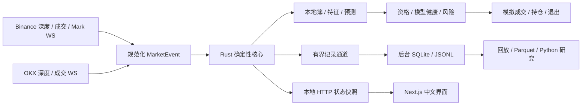

# 个人版实现说明

## 数据路径



`engine/src/core.rs` 不访问网络、数据库、系统时钟或随机数。输入包括显式 `Clock`；所有状态变化可由日志重现。公开 WS 各自异步连接，通过单一处理器串行化接收顺序。超出容量时停止新模拟风险，不静默忽略录制异常。

Binance 建立深度连接后请求 REST snapshot，再验证覆盖 snapshot 的首个 U/u 区间和后续 pu 链；断档重连并重新获取 snapshot。深度使用 `/public`，成交与标记价格使用 `/market`。OKX `books` 验证 prevSeqId/seqId 链，包括匹配前序的序号重置；合约数量通过 instruments API 的 ctVal 转为基础币数量，避免直接比较合约张数与 Binance 币数量。

参考核对（2026-10-02）：[Binance 订单簿同步](https://developers.binance.com/en/docs/products/derivatives-trading-usds-futures/websocket-market-streams/How-to-manage-a-local-order-book-correctly)、[Binance WS 路径](https://developers.binance.com/en/docs/products/derivatives-trading-usds-futures/websocket-market-streams/Connect)、[OKX API](https://www.okx.com/docs-v5/en/)、[OKX checksum 废弃说明](https://www.okx.com/en-gb/help/okx-order-book-channels-checksum-field-deprecation)。

## 与推荐架构的差异

保留 Rust 热路径、Python 研究与 TypeScript UI。将 PostgreSQL / MinIO 简化为单机 SQLite / 文件，降低个人部署成本。每秒状态快照的序列化仍在核心锁内，持久化提交在独立线程；这不是低延迟实盘系统的性能保证，未来高吞吐扩展应使用不可变增量快照并增加吞吐压测。

UI 通过本地同源 API 读取，控制操作要求自定义请求标记并校验 Origin。仅监听 loopback，没有公网身份认证；不要通过公网反向代理暴露。配置和控制操作等待后台持久化确认后才报告成功。订单结果与 checkpoint 在 SQLite 的同一事务提交，避免恢复后覆盖已经关闭的结果。

## 标签与模型

### 文档要求与当前基线

原始 [Feature & Model Contract](spec/02-domain-rules/FEATURE-MODEL-CONTRACT.md) 要求先验证确定性评分，再升级逻辑回归和树模型，使用校准概率进行决策；原文没有提供训练权重或历史有效性证据。当前代码按该框架实现观察闭环，评分权重属于实现时选择的待研究参数。

默认真实行情模型为 `score-v1-unvalidated`，其 `validated=false`、`calibration_version=none`，`calibrated_probabilities` 为空。演示模型的 `synthetic-only` 校准仅用于合成行情功能验证，不能作为真实来源的有效性证据。模型和配置会随 checkpoint 保存；重启恢复的是已有状态，不一定是默认基线。

### 计算频率与预测生命周期

每个标的一次只跟踪一条预测，方向稳定两秒后建立，最短创建间隔五秒。特征每秒更新；价格屏障对每个有效簿事件检查。超时后的价格不能改写先前结果。错向跳空保留实际尾部损失，不按止损价裁剪。

正式 `Prediction` 保存建立时的方向、概率、起点、屏障、期限、模型及配置版本；只持续更新跟踪价格、MFE / MAE 与状态。每秒的重新资格检查使用一份临时预测副本，将其中的概率更新为最新值，因此界面当前资格与原始判断可以不同。当前概率模型没有针对“剩余持有时间”重新建模；到期处理由独立的 Outcome / 持仓超时规则完成。

源码入口：[调度与时钟](../engine/src/main.rs)、[特征、预测、资格与结果](../engine/src/core.rs)、[界面轮询及展示](../web/app/page.tsx)。当前实时性意味着持续处理最新收到的数据；网络或进程调度延迟仍需通过新鲜度门槛处理。

### 评分与概率的具体含义

确定性评分在 [model.rs](../engine/src/model.rs) 中定义：

```text
score = clamp(
    1.5 × book_imbalance
  + 0.8 × flow_imbalance
  + 1.2 × aggressive_imbalance
  + 0.15 × microprice_bps
  + clamp(500 × momentum, -1, 1),
  -3, 3
)

raw_probabilities = softmax([score, -score, -0.2])
```

`clamp` 表示限制取值区间。当前正式预测的方向由评分符号决定：非负为 LONG，负为 SHORT；加载逻辑回归工件后，工件权重用于概率计算，候选方向仍采用上述评分规则。

概率顺序固定为 `[up_first, down_first, timeout]`；多单上屏障为 target、下屏障为 stop，空单相反。校准概率与原始概率分别保存。研究模型采用固定十维特征：常数项、簿失衡、订单流、主动成交、微价格、动量、波动、跨市场差价、spread、log(depth)。

评分基线直接使用上式的五类信号。Spread、深度、波动、跨市场关系同时用于成本、资格或状态检查；它们被计算和展示，不表示全部进入了基线方向评分。可靠 OI / 清算流尚未接入。

基线 logits 不显式依赖 horizon / target / stop，`-0.2` 的超时 logit 也是固定初始假设。因此原始百分比目前只是三类评分的归一化结果，尚未建立相应期限与屏障下的统计有效性。改变窗口或屏障不会自动训练出新的条件模型；即使屏障配置为 60 秒 / 0.30% / 0.10%，也不能把原始输出直接解释为这些条件下已经验证的真实频率。

离线模型采用温度校准 `softmax(logits / temperature)`。核心仅在模型标记通过验证，且其窗口、目标和反向屏障与配置匹配时输出校准概率；此外还有独立的近期样本、ECE、Model Trust 与交易资格检查。校准概率存在不等于风险门槛已经通过。

### 结果与健康评估

模型健康按 symbol / model_version / config_version 筛选可比样本；近期最多 100 条，前面的 200 条为基线。数据失效剔除，市场失败保留。不足样本为 LOW，不能产生完整交易计划；参数冻结，可信度可以独立变化。

预测学习记录 `Outcome`，交易学习记录 `TradeResult`，分别计算预测 EV 偏移和真实模拟成交成本偏移。人工注释独立追加，不训练生产权重。

当前默认最低近期样本数为 30 条 / 标的，具体取值由版本化配置决定。该阈值只用于运行时可信度检查；离线研究通过时间隔离的训练、校准和验证窗口另行验收。基线按超时条件下预期方向收益为零估算毛 EV，再扣除各项成本；未校准概率产生的正 EV 也不能越过 Calibration 门槛。

验证路径为：真实 OBSERVE 录制 → 自动 First-hit 结果 → 离线校准 / 逻辑回归比较 → 时间隔离的验证及连续子窗口报告 → 人工加载模型 → 新模型近期健康检查 → PAPER 成交评估。现有 [研究工具](../research/train.py) 不执行 Shadow、在线改权重或自动实盘晋升。源码中的 `validated` 是离线研究工件标记，不是交易所或实盘验收结论。

## 风险与恢复

以账户风险预算除以屏障距离加成本得到仓位，同时受到全账户名义价值、全账户杠杆、日剩余风险、流动性容量的共同上限约束。低可信度禁止新风险，DEGRADED 缩减预算并提高概率门槛。

PAPER 只能沿 `Prediction → Qualification → TradePlan → Execution → TradeResult` 链执行。平仓独立于新单资格，不会被日亏损阈值阻止。新预测以外不追单；同一预测内禁止加仓，用保守行为实现 no-martingale。保护性退出优先于减仓间隔 / 次数限制。

恢复读取最后提交的引擎 checkpoint，保留账户和持仓，将行情簿标为失效、模式改回 OBSERVE。已中断预测记为 INVALIDATED，持仓等待有效报价退出。默认 kill 行为 `hold`，`flatten` 需在配置中明确指定。仅关闭浏览器不会停止核心；Ctrl+C 使核心停止接收、提交最终状态并退出。

## API

| 路径 | 行为 |
|---|---|
| GET `/api/state` | 当前状态、近 100 个结果、配置和模型元数据 |
| GET `/api/health` | 存储健康、数据源与真钱禁用状态 |
| GET `/api/history?kind=outcome&limit=500` | 持久化历史，合并独立注释 |
| POST `/api/control/mode` | OBSERVE / PAPER；拒绝其他模式 |
| POST `/api/control/kill` | `{active: true/false}` |
| POST `/api/control/config` | 完整版本化风险与研究配置 |
| POST `/api/control/flatten` | `{symbol: "BTCUSDT"}` 模拟平仓 |
| POST `/api/control/annotate` | `{prediction_id, annotation}` |

POST 需要 `X-Micro-Alpha: local`，浏览器 Origin 必须为本机允许地址。金额以 USDT 计，比例采用小数（0.001 = 0.1%），bps 为万分之一，时间戳为毫秒。
